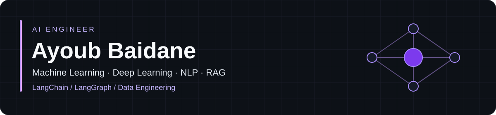
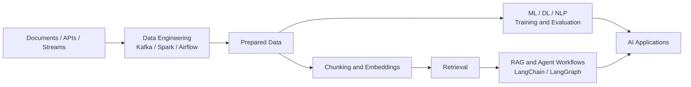
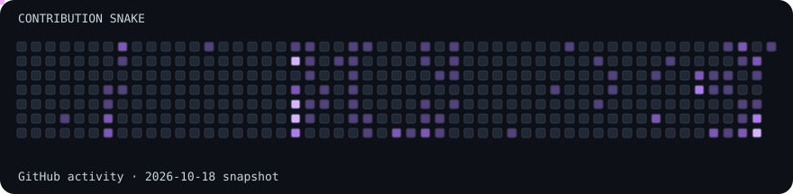

**Machine Learning · Deep Learning · NLP · RAG** 
**LangChain · LangGraph · Data Engineering**

## 👨‍💻 About Me

I'm **Ayoub Baidane**, an **AI Engineer** and **Big Data & Artificial Intelligence student at ENSA Tétouan**. My focus is **Machine Learning, Deep Learning, NLP and Retrieval-Augmented Generation (RAG)**, with **LangChain and LangGraph** for LLM applications and agent workflows.

I've also worked extensively on **Data Engineering**: real-time ingestion, ETL orchestration, distributed processing and databases. That experience shapes how I approach AI systems, from preparing reliable data to connecting models with useful applications.

| Focus | What I work with |
|---|---|
| **Machine Learning & Deep Learning** | Data preparation, model training and evaluation with TensorFlow and scikit-learn |
| **NLP & LLM applications** | Language models, text processing and retrieval-augmented generation |
| **RAG & agents** | Document ingestion, retrieval, grounded responses and workflows with LangChain & LangGraph |
| **Data Engineering** | Kafka, Spark, Airflow, Hadoop and PostgreSQL |
| **Collaboration** | Applied AI, NLP, RAG, agent workflows and data-intensive open-source projects |
| **Beyond AI** | Python, Docker and full-stack development with React, Node.js and Django |

### 🔁 What I build

## 🛠️ Tech Stack

**Languages** 

**AI Engineering · NLP · RAG** 
<strong>Machine Learning · Deep Learning · LangChain · LangGraph</strong>  

**Data Engineering & Big Data** 
 

**Machine Learning & Data Science** 
 

**Back-End & Front-End** 

**Databases** 

**DevOps, Cloud & Tools** 
 

## 🚀 Featured Projects

| Project | Area |
|---|---|
| [ML — Unsupervised Learning](https://github.com/baidaneayoub/ML-unsupervised-learning) | Machine Learning |
| [Real-time Cinema Data Engineering](https://github.com/baidaneayoub/realtime-cinema-data-engineering) | Data Engineering |
| [End-to-end Data Engineering](https://github.com/baidaneayoub/end-to-end-project-data-engineer) | Data Engineering |
| [E-commerce Real-time Analytics](https://github.com/baidaneayoub/ecommerce-realtime-analytics) | Data Engineering & Analytics |

## 📊 GitHub Stats

## 🐍 Contribution Snake

Contribution snapshot: 18 October 2026. Generated locally without paid services or scheduled Actions.

