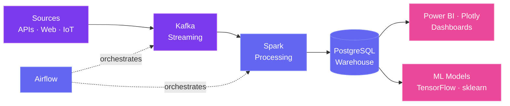

## 👨‍💻 About Me

I'm a 1st-year **Big Data and Artificial Intelligence (BDIA)** student at **ENSA Tétouan**, passionate about building robust data architectures and intelligent systems — on my way to becoming a **Data Engineer / Machine Learning Engineer**.

| | |
|---|---|
| 🔭 **Currently working on** | A real-time data pipeline — Kafka for streaming, Airflow for ETL orchestration, PostgreSQL for storage |
| 🤝 **Looking to collaborate on** | Open-source Data Engineering projects, AI hackathons, full-stack platforms |
| 🧠 **Looking for help with** | Scaling distributed processing with advanced Apache Spark & Hadoop architectures |
| 🌱 **Currently learning** | IBM Data Engineering & Meta Back-End Developer Professional Certificates |
| 💬 **Ask me about** | Python, Docker, full-stack web platforms (React / Node.js / Django) |
| ⚡ **Fun fact** | Helped build and launch a full-stack community platform for my major in 5 months. Off the keyboard, I'm grinding in Elden Ring |

### 🔁 What I build

## 🛠️ Tech Stack

**Languages** 

**Data Engineering & Big Data** 
 

**Machine Learning & Data Science** 
 

**Back-End & Front-End** 

**Databases** 

**DevOps, Cloud & Tools** 
 

## 🚀 Featured Projects

## 📊 GitHub Stats

## 🐍 Contribution Snake

<picture>
  <source media="(prefers-color-scheme: dark)" srcset="https://raw.githubusercontent.com/baidaneayoub/baidaneayoub/output/github-snake-dark.svg"/>
  
</picture>

